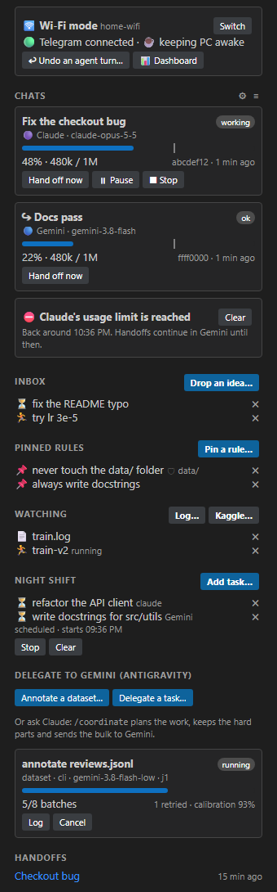
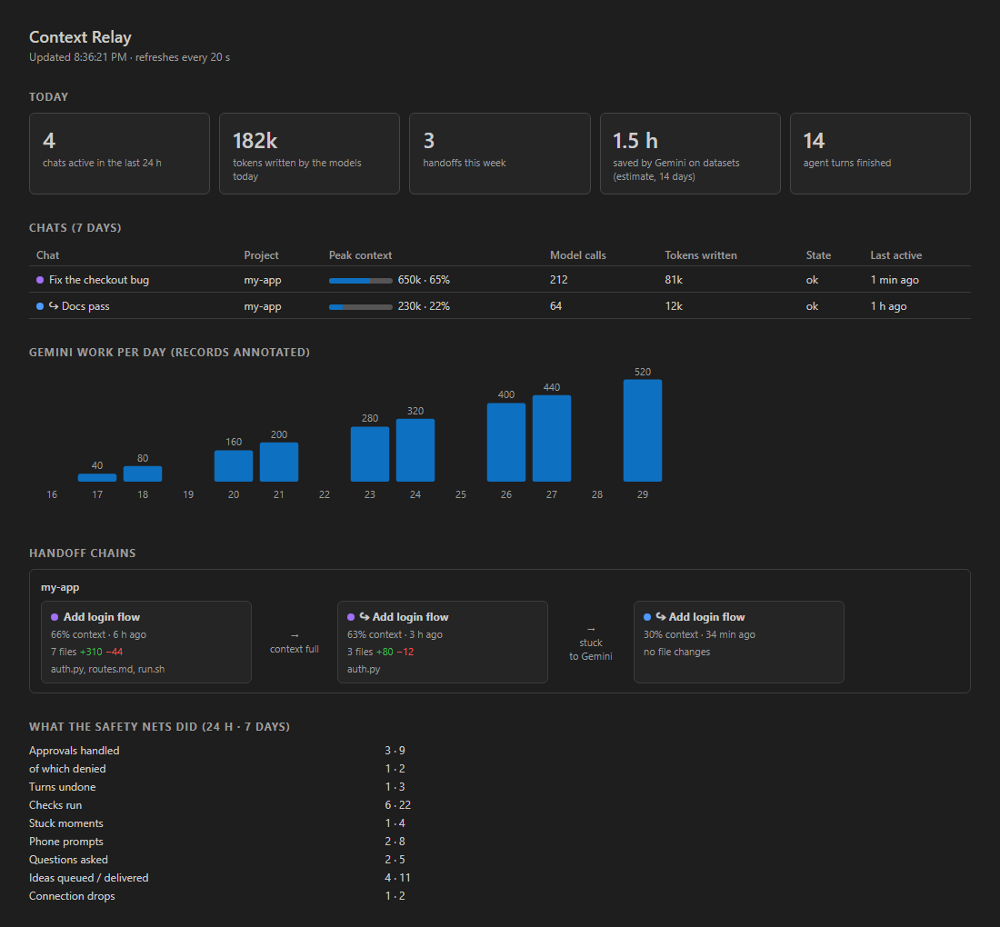
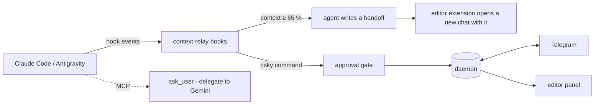

# Context Relay

**Calm vibe-coding with Claude Code and Gemini (Antigravity).**
Hand long chats over to a fresh one before quality drops, keep your agents from doing anything destructive, and steer everything from your phone.

[](https://github.com/YahiaKerroum/context-relay/actions/workflows/ci.yml)


<p align="center">
  
  &nbsp;&nbsp;
  
</p>

> Screenshots are rendered from sample data, so no real project shows up in them.

## Why

Long agent sessions go wrong in boring, predictable ways. The context window fills up and the answers get worse. An agent runs `rm -rf` or `git reset --hard` on the wrong folder. A model downloads 8 GB on your phone hotspot. You walk away and the agent sits waiting for a click. Context Relay deals with these so you can stay in flow, or leave the desk.

## What you get

| | Feature | What it does |
|---|---|---|
| 🔁 | **Context relay** | At 65 % of the model's window (configurable) the agent writes a structured handoff, and a **new chat opens with it already loaded**. Works in Claude Code (VS Code and compatible editors) and Gemini in Antigravity. |
| 🛑 | **Danger gate** | Destructive shell commands (recursive deletes, force-push, `git reset --hard`, `DROP TABLE`, package publish, ...) wait for your OK, on the desktop or on Telegram, even if you run the agent with permission prompts off. |
| 📶 | **Data guard** | On a metered connection or a hotspot you listed, big downloads (`pip install`, model pulls, `git clone`, Kaggle, Hugging Face) wait for your OK. |
| ↩️ | **Undo snapshots** | A hidden git repo records the tree at the start of every agent turn. One command undoes exactly what that turn changed. Your own git history is never touched. |
| 📌 | **Pinned rules** | "Never touch `data/`." Rules are re-injected into every chat and every handoff, and the paths you name become protected. |
| ✅ | **Done means green** | When an agent says it is finished, your tests and checks run first. If they fail, it keeps working. |
| 🌀 | **Stuck detector** | Repeated errors or edit loops are caught and escalated: a fresh chat, or a different model. |
| 📱 | **Telegram remote** | Message your agent, see what it is doing (live), get screenshots and dev-server previews, approve or deny with one tap, drop ideas into an inbox. Answers are limited to your paired chat. |
| ❓ | **`ask_user`** | The agent can ask you a real question when a decision is yours. It reaches your editor, then your phone. |
| 👀 | **Watchers** | Follow a training log or a Kaggle run; get a message when it finishes or fails. |
| 🌙 | **Night shift** | Queue tasks, start them at a time you choose, read the report in the morning. |
| 🤝 | **Gemini delegation** | Claude hands bulk work (labeling datasets, docstrings, translations) to Gemini in Antigravity through MCP tools and the `/coordinate` skill. Includes calibration items and an optional inter-rater check. |
| 📊 | **Dashboard** | Chats, peak context, handoff chains, what the safety nets did, time Gemini saved you. |

Everything is on by default except the inter-rater check, and every part can be switched off in the settings.

## Support

| | Windows | macOS / Linux |
|---|---|---|
| Context relay, handoffs, rules, stuck detector, checks | ✅ | ✅ (written for it, **not yet tested on a real machine**; CI runs the test suite on Linux) |
| Danger gate, data guard, undo snapshots | ✅ | ✅ (same caveat) |
| Telegram text control, approvals, `ask_user`, watchers | ✅ | ✅ (same caveat) |
| Gemini delegation | ✅ | ✅ (same caveat) |
| `/screenshot`, locked-screen detection, auto-send in the new chat, keep-PC-awake | ✅ | ❌ not available |

Tested here: Windows 11, Python 3.13, Claude Code in VS Code, Antigravity IDE and CLI. Reports from other setups are welcome, please [open an issue](https://github.com/YahiaKerroum/context-relay/issues).

You need Python 3.10 or newer and git. Everything else is optional: Claude Code, the Antigravity CLI (`agy`), a VS Code-compatible editor (VS Code, Cursor, Windsurf, Antigravity IDE), a Telegram account. The installer detects what you have and skips what you don't.

## Quick start

```bash
# 1. install
pip install git+https://github.com/YahiaKerroum/context-relay.git

# 2. check your machine (changes nothing)
context-relay doctor

# 3. set up: asks before each step, backs up your settings first
context-relay setup
```

Then **reload your editor window** (command palette → *Developer: Reload Window*). A Relay icon appears in the activity bar and the hooks are live in the next Claude Code or Antigravity chat.

Want to see exactly what will change first? `context-relay setup --dry-run`. Want no questions? `context-relay setup --yes`.

<details>
<summary>What <code>setup</code> changes on your machine</summary>

- `~/.claude/settings.json`: adds hooks for Claude Code (session start, prompt submit, pre-tool-use, stop, ...) and a status line. Your own hooks and status line are kept, and a backup is written next to the file.
- `~/.gemini/config/hooks.json`: the same for Antigravity.
- Registers an MCP server with Claude Code (delegation tools, `ask_user`) and with `agy` (`ask_user`).
- Installs `~/.claude/skills/coordinate` (the `/coordinate` skill).
- Installs the editor extension into every supported editor it finds.
- Starts a small background helper (Telegram, network detection, presence) and starts it again at login.
- Writes `~/.context-relay/config.json` with only the settings that differ from the defaults (for example your detected Claude window).

`context-relay uninstall` reverses all of it (see [Uninstall](#uninstall)).
</details>

### Connect your phone (optional, 2 minutes)

1. In Telegram, talk to [@BotFather](https://t.me/BotFather), send `/newbot`, pick a name, and copy the token.
2. Run `context-relay telegram setup`. Paste the token when asked (it is not echoed).
3. Open your bot in Telegram, press **Start**, and send the six-digit pairing code that setup printed (`context-relay telegram pair` shows it again). That chat is now paired; the bot ignores everyone else.

Details, commands and tips: [docs/telegram.md](docs/telegram.md).

## Using it

You mostly don't. Work as usual.

- **Around 50 %** of the window you get a heads-up; at **65 %** the agent is asked to write a handoff. The new chat opens with it, and continues where the old one stopped. Click **Hand off now** in the panel to do it earlier.
- **A risky command** shows an approval prompt in the editor and on your phone. Approve or deny.
- **Something went wrong?** `Context Relay: Undo an Agent Turn` (command palette), or `/undo` in Telegram.
- **Leaving?** Say `/away` on Telegram. Locking your PC or going idle does it for you, and a "while you were away" card is waiting when you come back.

All commands live in the command palette under **Context Relay**, and in the side panel.

### The Telegram commands

| | |
|---|---|
| Talk | just type · `/chats` · `/new task` · `/drop idea` · `/inbox` |
| See | `/status` · `/live` · `/screenshot` · `/preview [port]` · `/missed` |
| Steer | `/pause` · `/resume` · `/stop` · `/handoff` · `/tests` · `/commit` · `/summary` · `/undo` |
| Rules | `/rule text` · `/rules` · `/unrule id` |
| Watch | `/watch path` · `/kaggle user/slug` · `/watchers` |
| Modes | `/away` · `/back` · `/mode wifi\|data\|auto` · `/limit [off]` · `/night` |

## Configuration

Open **Context Relay: Settings** in the editor, or edit `~/.context-relay/config.json` (only the keys you want to change; everything else follows the defaults, including future ones).

```jsonc
{
  "threshold_pct": 65,              // hand off at this % of the model's window
  "claude_window_tokens": 1000000,  // 200000 or 1000000; setup detects it from your chats
  "guard": { "danger_gate": true, "data_guard": true, "extra_danger_patterns": [] },
  "network": { "mode": "auto", "data_ssids": ["My Phone"] },  // treat these Wi-Fi names as metered
  "telegram": { "notify": "away", "approvals": "away" }       // "away" | "always" | "off"
}
```

**"Done means green"** finds your checks by itself: `tests/test_*.py` (pytest or unittest), `npm test`, and `ruff check` when ruff is configured. To choose your own, put `{"commands": ["pytest -q", "npm run lint"]}` in `<project>/.context-relay/checks.json`.

The full list of keys and defaults is in [`relay.py`](src/context_relay/relay.py) (`DEFAULTS`).

> **Which window do I have?** Claude Code can run with a 200k or a 1M-token window, depending on your plan and model. Setup reads your recent chats to find out; if it guesses wrong, set `claude_window_tokens` or run `context-relay setup --claude-window 1m`.

## How it works



The hooks are tiny Python processes started by the agent for each event; they read the transcript, count tokens, and decide. A small background daemon owns everything that needs a long-lived connection (Telegram polling, network detection, presence). The editor extension draws the panel and opens the new chat. There are **no runtime dependencies** and no servers other than Telegram's own API and, optionally, your local dev server for previews.

More detail: [docs/how-it-works.md](docs/how-it-works.md).

## Command reference

```text
context-relay setup | uninstall | status | doctor | version
context-relay telegram setup | pair | status | unpair
context-relay run claude|agy "task"           autopilot: headless sessions back to back
context-relay annotate --input F --instructions T --fields "label:pos|neg"
context-relay delegate-task --task T          hand a tedious task to Gemini
context-relay job list | status | wait | cancel | resume
context-relay inbox | rule | watch | night | stats
context-relay snapshots | changes | undo
context-relay build-vsix                      build the editor extension for manual install
```

`python -m context_relay ...` works everywhere `context-relay ...` does.

## Security and privacy

- Context Relay runs **entirely on your machine**. It sends nothing anywhere except to Telegram, and only if you set the bot up.
- The Telegram token is stored in `~/.context-relay/secrets.json` (permissions `600` where the OS supports it). The bot answers **only the paired chat**.
- Anyone who controls your Telegram account or your paired chat can steer your agents. Turn on two-step verification in Telegram.
- The danger gate is a safety net, not a sandbox. It catches common destructive commands with pattern matching; it cannot catch everything. Keep backups and use git.
- Hooks **fail open**: if Context Relay itself crashes, your agent keeps working instead of freezing. Check `~/.context-relay/relay.log`.

Report vulnerabilities as described in [SECURITY.md](SECURITY.md).

## Troubleshooting

`context-relay doctor` finds most problems. Common ones (full list in [docs/troubleshooting.md](docs/troubleshooting.md)):

- **Nothing happens after setup** → reload the editor window; start a *new* chat (existing chats keep the old hooks).
- **Handoff triggers too early or too late** → your window size is wrong. `context-relay setup --claude-window 1m` (or `200k`).
- **`context-relay` not found** → your Python scripts folder is not on `PATH`; use `python -m context_relay` instead.
- **Telegram silent** → `context-relay telegram status`, then see the log: `~/.context-relay/relay.log`.

## Uninstall

```bash
context-relay uninstall           # removes hooks, MCP entries, skill, extension, background helper
context-relay uninstall --purge   # also deletes ~/.context-relay (settings, handoffs, history)
pip uninstall context-relay
```

Your own Claude and Antigravity settings are restored to what they were; the backups taken during setup stay next to them.

## Development

```bash
git clone https://github.com/YahiaKerroum/context-relay.git
cd context-relay
pip install -e ".[dev]"
cd tests && python -m unittest discover -s .     # 66 tests, a few seconds
ruff check .
```

Tests use a throwaway home directory and never touch your real settings. See [CONTRIBUTING.md](CONTRIBUTING.md).

## License

[MIT](LICENSE) © Yahia Kerroum
