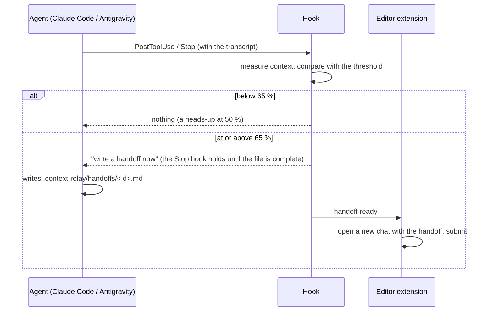

# How it works

Context Relay is three small pieces that talk through files in `~/.context-relay/`.

| Piece | Runs as | Job |
|---|---|---|
| **Hooks** | `python -m context_relay claude-hook` / `agy-hook` | Short-lived processes started by Claude Code or Antigravity on each event. They read the chat, decide, and exit. |
| **Daemon** | `python -m context_relay daemon` | One background process: Telegram polling, network and presence detection, watchers, night shift, keeping the PC awake. |
| **Editor extension** | `local.context-relay` | The side panel and dashboard, approval prompts, and the part that opens the new chat. |

The pieces mostly talk through small JSON files (approvals, questions, notifications, state) rather than calling each other. A crash in one piece does not take the others down, and the hooks start fast: they have no dependencies and no network code on the hot path.

## The relay



1. **Measure.** Claude's transcript reports exact token usage for every turn. The percentage is `tokens / window`, where the window is `claude_window_tokens` (detected at setup) or `agy_window_tokens`.
2. **Ask for a handoff.** Past the threshold the Stop hook asks the agent to write a structured handoff. The required sections (`## Goal`, `## Status`, `## Next steps`, configurable) are checked; an incomplete file is sent back (`max_stop_blocks` limits how often).
3. **Open the new chat.** The extension opens a fresh chat in the same editor with a first message that points at the handoff file and tells the agent to re-check the current state before continuing. On Windows the extension submits it for you; elsewhere press Enter once.
4. **Carry the rules over.** Pinned rules are injected into every new chat.

Handoffs are plain Markdown in `<project>/.context-relay/handoffs/`. Read them, edit them, delete them.

## Safety nets

* **Danger gate.** The `PreToolUse` hook looks at every shell command before it runs. If it matches a destructive pattern (the `DANGER` list in [`guard.py`](../src/context_relay/guard.py)), the hook writes an approval request and waits, up to `guard.approval_timeout_min` (default 10). The daemon shows it in the editor and on Telegram with Approve and Deny buttons. **No answer means deny.** Recursive deletes of obvious scratch locations (temp folders, build output, caches) are let through.
* **Data guard.** Same mechanism for large downloads, but only in *data mode*: a metered connection, a Wi-Fi name listed in `network.data_ssids`, or `/mode data`.
* **Undo snapshots.** At the start of each agent turn a hidden git repo under `~/.context-relay/snapshots/` records your working tree. Undo restores the files that turn changed. Large files (`snapshots.max_file_mb`) are skipped and snapshots are kept `snapshots.keep_days` days. Your project's own `.git` is not touched.
* **Pinned rules.** Stored in `~/.context-relay/rules.json`. Paths you name in a rule are protected: edits to them wait for your OK.
* **Done means green.** When the agent tries to finish, the Stop hook runs your checks (auto-detected, or from `.context-relay/checks.json`). If checks fail that were not already failing before the turn, the agent is told what broke and keeps going, up to `checks.max_rounds` times.
* **Stuck detector.** Repeated tool errors, or many edits to the same file, trigger a nudge and then an escalation (a fresh chat, or the other model). See the `stuck` settings.

All hooks **fail open**: an exception inside Context Relay writes a line to `relay.log` and lets the agent continue.

## Telegram

The daemon long-polls the Telegram Bot API with your bot token. Updates from any chat other than the paired one are dropped before they reach a handler. Your text is delivered to the current chat; `/screenshot` and `/preview` capture the screen or your dev server and upload the image; buttons on approvals call back into the daemon. In data mode images are smaller and the live view updates less often.

## Delegation to Gemini

Claude gets MCP tools (`gemini_run_task`, `gemini_annotate_dataset`, `gemini_job_status`, `gemini_job_cancel`, `gemini_job_resume`) and the `/coordinate` skill that explains when to use them. A dataset job is split into batches, each run in Antigravity (CLI or IDE) with a few known-answer calibration items mixed in; a batch under `delegation.calibration_min_accuracy` is retried. The optional inter-rater check has a second model relabel a sample and reports agreement. Jobs can be resumed: `context-relay job resume ID`.

## Files

```text
~/.context-relay/
  config.json       your overrides only
  secrets.json      Telegram token and chat id (never commit this)
  relay.log         what the hooks and daemon did
  state/            one file per chat
  approvals/ questions/ notify/    short-lived request files
  snapshots/        the undo repos
  jobs/             Gemini jobs
  events.jsonl      what the dashboard shows
<project>/.context-relay/
  handoffs/         the handoff Markdown files
  checks.json       optional: your own check commands
```
